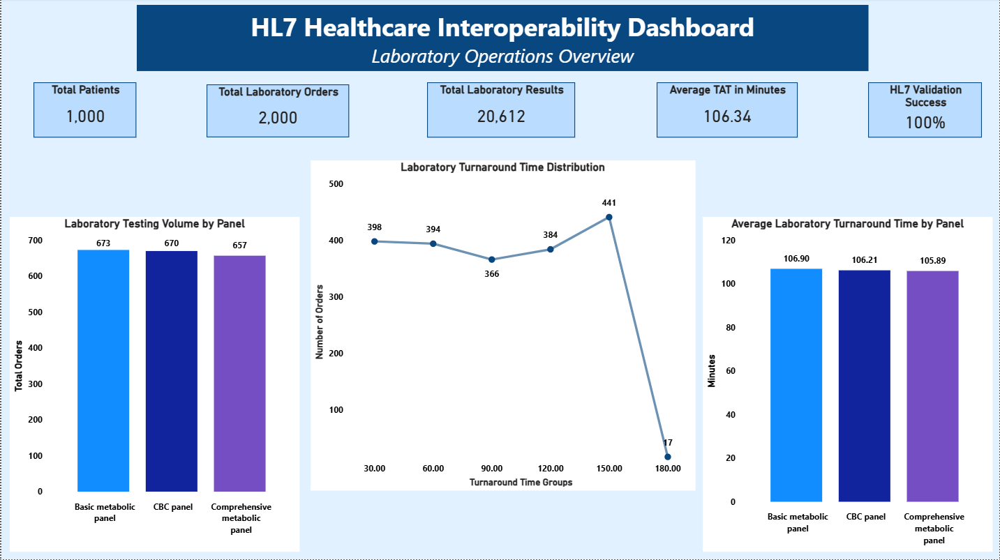
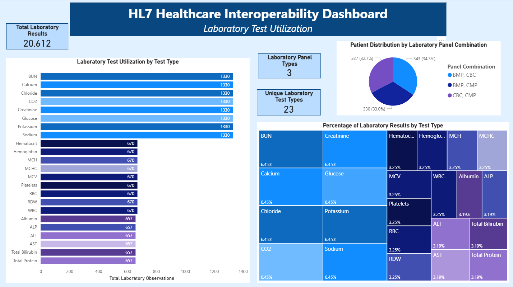
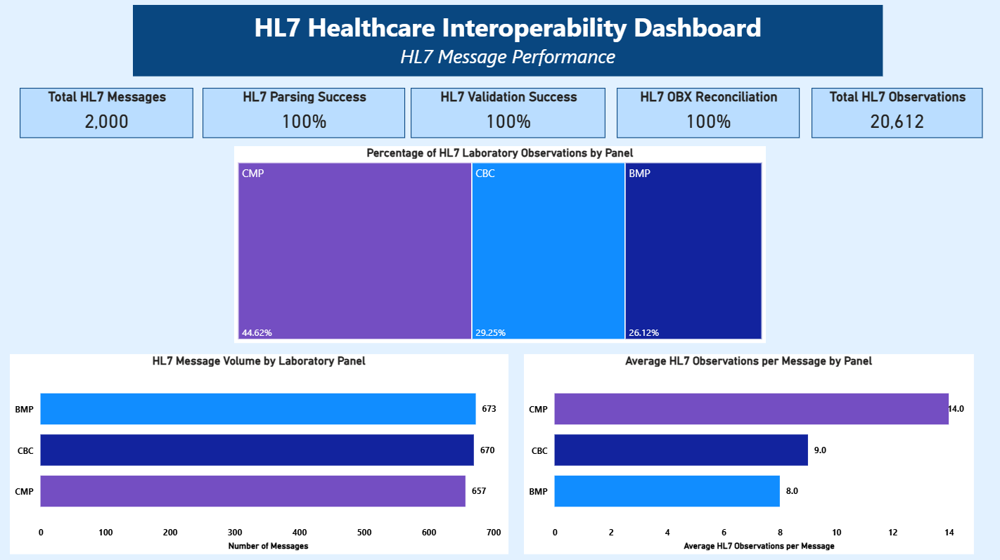

# HL7 Healthcare Interoperability and Laboratory Analytics

## Project Overview

This project demonstrates an end-to-end healthcare data integration and analytics workflow using Python, HL7 laboratory messages, PostgreSQL, SQL, and Microsoft Power BI.

The project simulates how laboratory information moves between healthcare systems, beginning with synthetic patient and laboratory testing data and continuing through HL7 message generation, parsing, validation, relational database storage, and business intelligence reporting.

The objective was to develop a workflow that maintains data consistency and traceability while transforming laboratory information into meaningful operational and interoperability metrics.

**All patient and laboratory data used in this project are synthetic. No real patient information is included.**

## Technologies Used

- **Python:** Synthetic data processing, HL7 message generation, parsing, and validation
- **Jupyter Notebook:** Development, execution, and documentation of the Python workflow
- **HL7 v2 Messaging:** Simulation of laboratory result communication using structured HL7 messages
- **PostgreSQL:** Relational database storage and analytical data preparation
- **pgAdmin 4:** Database development, administration, and SQL query execution
- **SQL:** Relational tables, integrity constraints, analytical views, and data aggregation
- **Microsoft Power BI:** Interactive dashboards and laboratory performance reporting

## Project Workflow

The project follows six primary stages:

1. **Synthetic Data Preparation:** Create and organize synthetic patient information, laboratory orders, and laboratory results.
2. **HL7 Message Generation:** Generate laboratory messages containing patient, order, and observation information.
3. **HL7 Parsing:** Extract structured information from generated HL7 messages into analytical datasets.
4. **Data Validation and Reconciliation:** Evaluate message parsing, validation outcomes, and agreement between expected results and HL7 observation counts.
5. **PostgreSQL Database Integration:** Organize laboratory information into relational tables and develop SQL views for reporting.
6. **Power BI Visualization:** Connect analytical data to dashboards showing laboratory operations, test utilization, and HL7 message performance.

## Synthetic Dataset

The simulated healthcare environment includes:

| Metric | Total |
|---|---:|
| Synthetic Patients | 1,000 |
| Laboratory Orders | 2,000 |
| Laboratory Results | 20,612 |
| HL7 Messages | 2,000 |
| Unique Laboratory Test Types | 23 |
| Laboratory Panel Types | 3 |

The laboratory testing environment includes three commonly ordered panels:

- **Basic Metabolic Panel (BMP)**
- **Complete Blood Count (CBC)**
- **Comprehensive Metabolic Panel (CMP)**

These panels provide a practical foundation for evaluating laboratory testing volume, utilization patterns, result distribution, and message-level interoperability.

## HL7 Message Generation and Validation

Python was used to develop and process synthetic HL7 laboratory messages.

The workflow includes message generation, parsing, validation, and reconciliation of laboratory observations.

Validation activities evaluate whether messages were processed successfully and whether the number of extracted HL7 observations matched the expected laboratory result counts.

### HL7 Performance Results

| Performance Measure | Result |
|---|---:|
| HL7 Parsing Success | 100% |
| HL7 Validation Success | 100% |
| HL7 OBX Reconciliation | 100% |
| Total HL7 Observations | 20,612 |

All 2,000 simulated HL7 messages successfully passed the parsing, validation, and observation reconciliation checks included in the project.

These results demonstrate internal consistency within the simulated workflow. They do not represent validation against an external production electronic health record or laboratory information system.

## PostgreSQL Database Design

PostgreSQL was used to organize the generated healthcare information into a relational database.

### Database Tables

Five tables support the project:

| Table | Purpose |
|---|---|
| `patients` | Stores synthetic patient demographic information |
| `laboratory_tests` | Defines laboratory test names, LOINC codes, and units |
| `laboratory_orders` | Stores laboratory orders, panels, and collection/result timestamps |
| `laboratory_results` | Stores individual laboratory observations and result values |
| `hl7_messages` | Stores HL7 message identifiers, processing statuses, and observation counts |

Primary keys, foreign keys, uniqueness constraints, and other database checks support relational integrity.

### Analytical SQL Views

Five PostgreSQL views were developed to support reporting:

| SQL View | Analytical Purpose |
|---|---|
| `vw_hl7_performance` | HL7 parsing, validation, and observation reconciliation |
| `vw_panel_volume` | Laboratory order and result volume by panel |
| `vw_patient_utilization` | Patient-level laboratory utilization and panel combinations |
| `vw_test_utilization` | Individual laboratory test frequency and result distribution |
| `vw_turnaround_time` | Laboratory turnaround time calculated from collection and result timestamps |

These views provide structured reporting datasets for Microsoft Power BI.

## Power BI Dashboard

The Power BI dashboard contains three pages designed to evaluate laboratory operations and healthcare data interoperability.

### 1. Laboratory Operations Overview

This page summarizes laboratory activity and turnaround time performance.

Key measures include:

- Total patients, laboratory orders, and laboratory results
- Average laboratory turnaround time
- HL7 validation success
- Laboratory testing volume by panel
- Turnaround time distribution
- Average turnaround time by panel

**Average laboratory turnaround time: 106.34 minutes**

### 2. Laboratory Test Utilization

This page explores how laboratory testing is distributed across individual tests and panel combinations.

Visualizations include:

- Laboratory test utilization by test type
- Patient distribution by laboratory panel combination
- Percentage of laboratory results by test type

A coordinated blue and purple color scheme distinguishes laboratory panels and their associated tests.

### 3. HL7 Message Performance

This page focuses on the completeness and consistency of simulated HL7 laboratory messages.

Key measures include:

- Total HL7 messages
- HL7 parsing success
- HL7 validation success
- HL7 OBX reconciliation
- Total HL7 observations
- Message volume and observation distribution by panel

The dashboard provides a consolidated view of both laboratory operational metrics and message processing performance.

## Dashboard Screenshots

### Laboratory Operations Overview

### Laboratory Test Utilization

### HL7 Message Performance

## Key Findings

The project produced several notable results:

- The simulated environment generated 2,000 laboratory orders and 20,612 individual laboratory results for 1,000 patients.
- All 2,000 HL7 messages passed the implemented parsing and validation checks.
- HL7 observation counts reconciled with expected laboratory result counts across the generated messages.
- Laboratory panel volumes were relatively balanced, with 673 BMP orders, 670 CBC orders, and 657 CMP orders.
- CMP accounted for the largest share of laboratory observations because it contains more individual tests per panel.
- Average laboratory turnaround time was approximately 106 minutes, with similar averages across the three panels.

## Project Files

The repository includes the following project components:

- `HL7_Laboratory_Integration.ipynb` — Python and Jupyter Notebook workflow
- `HL7_Healthcare_Interoperability_Dashboard.pbix` — Power BI dashboard
- `*.hl7` — Generated synthetic HL7 laboratory messages
- `*.csv` — Synthetic datasets, parsed records, and validation outputs
- `*.sql` — PostgreSQL table definitions and analytical views

## Project Limitations

This project uses synthetic healthcare data and a simulated HL7 integration workflow.

The successful validation results reflect the checks implemented within this environment and should not be interpreted as evidence of production interoperability certification, clinical validation, or real-world system performance.

The Power BI report was developed using a local PostgreSQL environment. Opening the report with live data connectivity may require configuring a corresponding PostgreSQL database and updating the connection settings.

## Conclusion

This project brings together laboratory science, healthcare data interoperability, relational database development, and business intelligence.

By building the workflow from synthetic data generation through HL7 messaging, validation, PostgreSQL integration, and Power BI reporting, the project demonstrates how healthcare data can be transformed into reliable and useful operational information.

The project also highlights the importance of data quality, message reconciliation, relational integrity, and clear visualization when developing analytics solutions for healthcare organizations.
